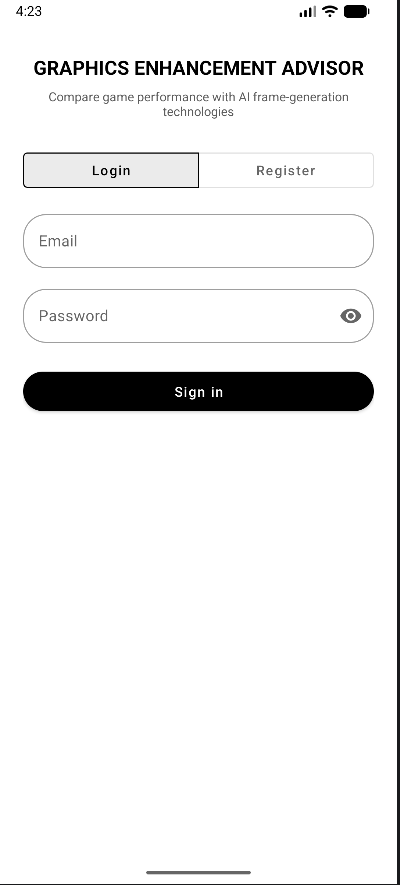
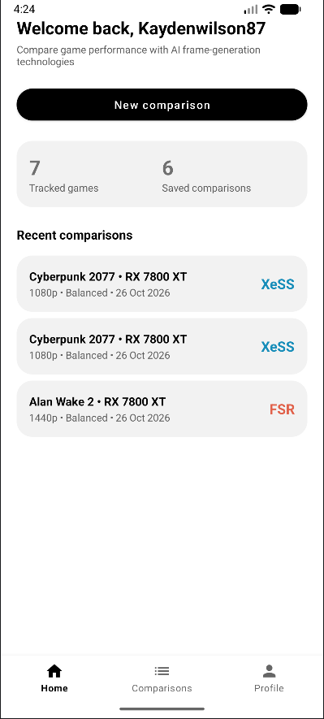
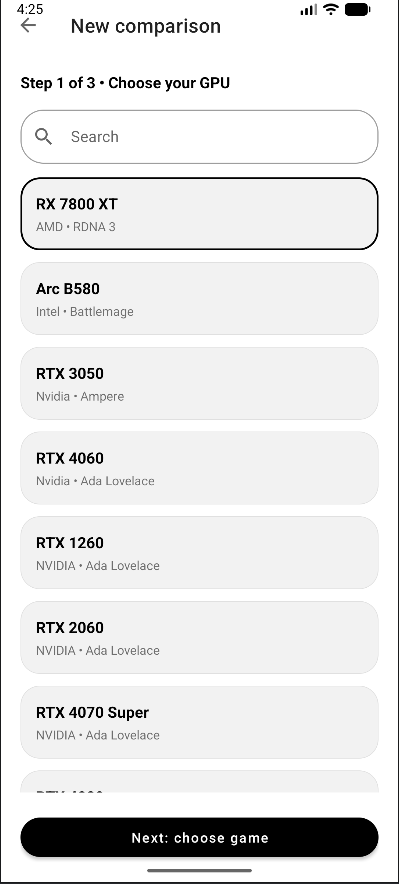
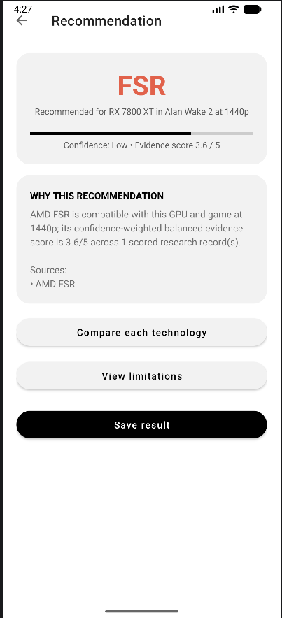
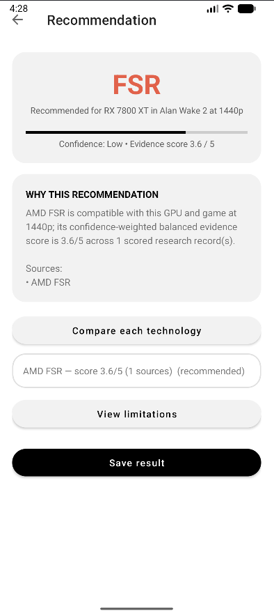
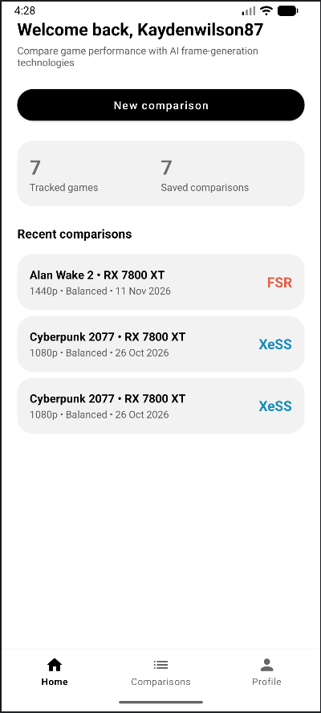
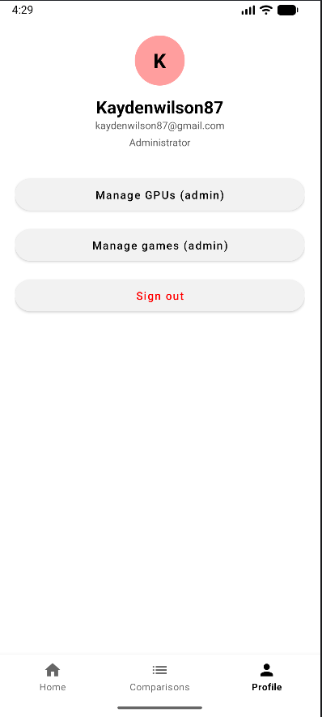
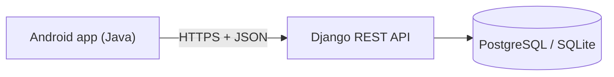

# Graphics Enhancement Advisor

[](https://github.com/kaydenwilson87/Graphics-Enhancement-Advisor/actions/workflows/ci.yml)


An Android app that helps PC gamers choose between **NVIDIA DLSS**, **AMD FSR** and **Intel XeSS**. You pick a GPU, a
game, a resolution and a preference (performance, image quality or balanced), and the app recommends a technology and
**explains why**, with its sources, a confidence level and known limitations.

It does not run live benchmarks. Every answer comes from compatibility records and cited research evidence held on the
server, and when there is no evidence the app says so instead of guessing.

## Screenshots

| Login | Home | Wizard |
|---|---|---|
|  |  |  |

| Recommendation | Compare options | Saved comparisons | Admin |
|---|---|---|---|
|  |  |  |  |

## Try it

- **Install the app:** download the latest APK from the [Releases](../../releases) page and open it on an Android phone.
- **Live API:** [health check](https://graphics-enhancement-advisor-1.onrender.com/health/). It runs on a free host, so the
  first request after a quiet period can take about a minute.

## Features

- **Accounts:** register, log in and out. The login is stored encrypted on the phone, so users stay signed in.
- **Comparison wizard:** GPU, then game, then resolution and preference, with search on the lists.
- **Explainable recommendation:** the chosen technology, a confidence level, reasons, research sources, a side-by-side
  comparison of every option and the limitations.
- **Saved comparisons:** save a result, search and filter the list, edit a note, delete.
- **Admin tools:** staff accounts add, edit and delete GPUs and games from inside the app.
- **Resilient UI:** form validation, loading states, confirmation dialogs, and a Retry button on every network error.

## How it works



More detail, including the data model and the recommendation flow, is in [docs/ARCHITECTURE.md](docs/ARCHITECTURE.md).
The reasoning behind the main choices is in [docs/DECISIONS.md](docs/DECISIONS.md).

| Part | Folder | Technology |
|---|---|---|
| Mobile app | `app/` | Java, Android Views, Material Components (min SDK 24) |
| Backend API | `backend/Graphics-enhancement-advisor-backend/` | Python, Django, Django REST Framework, JWT |
| Web admin | `php-admin/` | PHP portal that uses the same API |

## Engineering highlights

- **Tested:** Django API tests cover registration, permissions, private data, recommendations and input validation.
  Android unit tests cover the mapping and error-handling logic.
- **Continuous integration:** every push builds the app, runs both test suites and uploads the APK
  (see `.github/workflows/ci.yml`).
- **Clean seams:** screens depend on repository interfaces, never on networking code.
- **Security basics:** hashed passwords, staff-only writes, per-user data isolation, rate-limited registration,
  Keystore-encrypted refresh token, and no secrets in the app or the repository.

## Run it locally

### Backend

Requires Python 3.10 or newer.

```sh
cd backend/Graphics-enhancement-advisor-backend
python -m venv .venv
.venv\Scripts\activate            # Windows  (macOS/Linux: source .venv/bin/activate)
pip install -r requirements.txt
cp .env.example .env              # Windows: copy .env.example .env
python manage.py migrate
python manage.py createsuperuser  # this account is the app's admin
python manage.py runserver 0.0.0.0:8000
```

Check `http://127.0.0.1:8000/health/`. The local database is SQLite and needs no setup. The server only recommends a
technology when it has compatibility and evidence data, so add GPUs, games and evidence at `/admin/`.

### Android app

1. Open the top-level folder in Android Studio and let Gradle sync.
2. The app points at the hosted API by default (`apiBaseUrl` in `gradle.properties`). To use a local backend from the
   emulator, build with `-PapiBaseUrl=http://10.0.2.2:8000/api/v1/`.
3. Run on an emulator or a phone with USB debugging.

Accounts: register in the app for a normal user. The account made with `createsuperuser` is a staff account and shows the
*Manage GPUs* and *Manage games* buttons on the Profile tab.

## Tests

```sh
# Backend (from the backend folder)
python manage.py test

# Android unit tests (from the repository root)
./gradlew testDebugUnitTest      # Windows: gradlew.bat testDebugUnitTest
```

## API

All paths are under `/api/v1/`.

| Purpose | Request |
|---|---|
| Register / log in / refresh | `POST auth/register/`, `POST auth/token/`, `POST auth/token/refresh/` |
| Current user and admin flag | `GET auth/me/` |
| GPUs and games | `GET gpus/`, `GET games/` (staff only: `POST`, `PUT`, `DELETE`) |
| Recommendation | `POST recommendations/` with `gpu_id`, `game_id`, `resolution`, `preference` |
| Saved comparisons | `GET`, `POST saved-comparisons/`, `PUT`, `DELETE saved-comparisons/<id>/` |

The backend's own [README](backend/Graphics-enhancement-advisor-backend/README.md) has more detail, and
[DEPLOYMENT.md](DEPLOYMENT.md) covers hosting and environment variables.

## Roadmap

Planned next, in order:

1. Recommendations for **in-game settings** (FPS cap, anti-aliasing and more), not only the upscaler.
2. A richer **profile** with saved hardware ("My PC") and history.
3. A grounded **AI assistant** that answers questions using the project's own data.
4. A **Windows companion** that reads hardware specs automatically.
5. A more interactive UI, with new screens in Kotlin and Jetpack Compose.

## Known limitations

- No forgot-password flow yet, because the API has no endpoint for it.
- Compatibility and evidence records are managed on the server's admin page, not in the app.
- Recommendations are only as good as the evidence entered, so demo data must be replaced with real, cited sources.
- Compatibility suggestions fetched automatically from a public source stay out of results until staff verify them.

## Credits

Started as a college group project (course ITMDA) by Kayden Wilson, Donel Kia Nzambi, Ismail Peterson,
Kabanga Kalonji Christian Kabedi, Sebastian Duvenhage and Sinaso Martins. The Django backend was originally written by
Donel-KZ. The Android app and the continuing development are by Kayden Wilson.

Released under the [MIT License](LICENSE).
