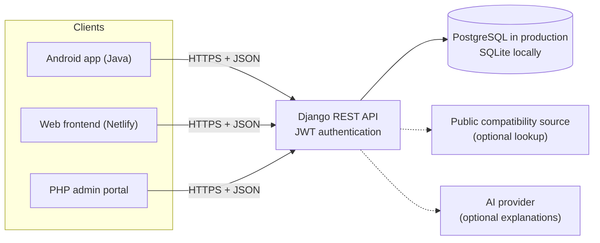
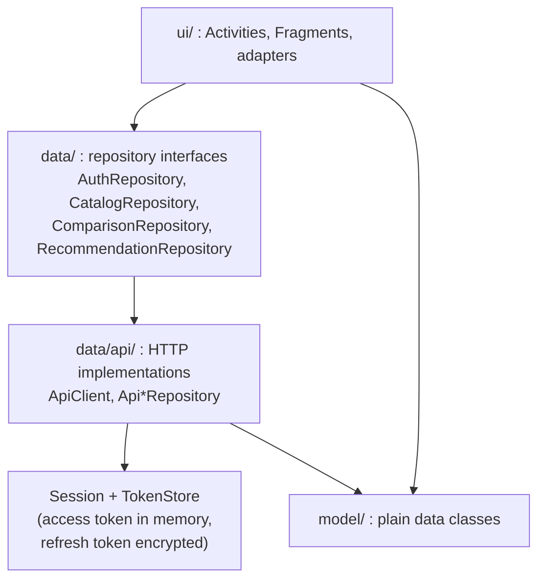
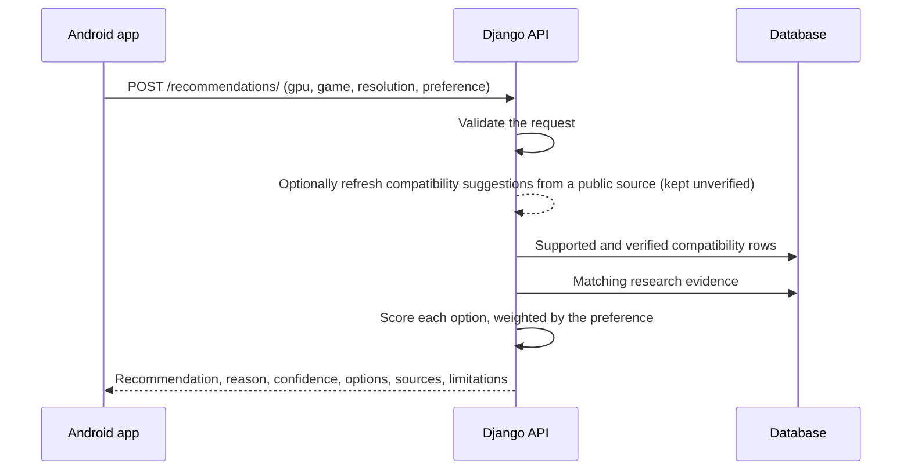
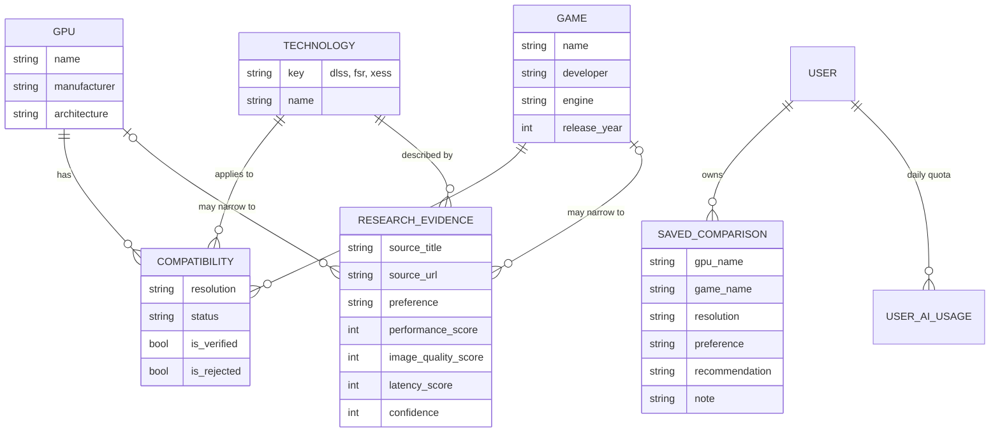

# Architecture

## System overview

The Android app and the two web clients all use the same API. The API holds every rule and every record, so
the clients stay thin.

## Inside the Android app

- Screens only know the repository **interfaces**. Swapping the data source (an in-memory fake, a different server)
  means changing one line in `Repos.java`.
- `ApiClient` runs every request on a background thread, delivers results on the main thread, and refreshes an
  expired access token once before giving up.
- `TokenStore` keeps the refresh token encrypted with a key held in the Android Keystore, so users stay signed in
  without the token ever being stored as plain text.

## How a recommendation is produced

The result is **explainable**: every option carries its evidence and sources. When there is no scored evidence the
server says so instead of guessing.

## Data model

## Security notes

- Passwords are checked by Django's validators (minimum 10 characters) and stored hashed.
- Writes to the GPU and game catalogue are limited to staff accounts. Saved comparisons are visible only to their owner.
- Registration and AI endpoints are rate limited.
- Secrets (`SECRET_KEY`, database address, API keys) come from environment variables and are never committed.
- The app contains no secrets. Anything sensitive stays on the server.
